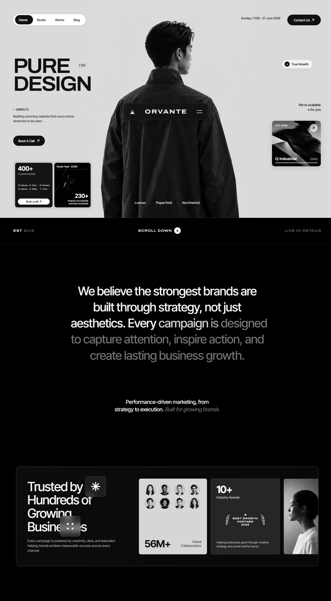

# Orvante — Strategic Brand & Digital Design Agency

> An award-winning, editorial monochrome landing page for an elite branding and design agency, crafted with semantic HTML5, modern vanilla CSS, and vanilla JavaScript.



## Overview

**Orvante** is a high-concept landing page designed around a strict monochrome editorial aesthetic. The design is structured around three core sections with bespoke micro-animations, responsive scaling, and GPU-accelerated motion sequences.

## Live Deployment

- **Vercel Live Demo**: [https://orvante-agency.vercel.app](https://orvante-agency.vercel.app)
- **GitHub Repository**: [https://github.com/aanasmahfouz/orvante-agency](https://github.com/aanasmahfouz/orvante-agency)

## Architectural & Design Highlights

1. **Section 1: Hero Experience (1440 × 938u)**
   - Studio black-and-white editorial portrait with custom 6% horizontal alpha gradient masks melting seamlessly into the `#dadada` paper canvas.
   - Interactive segmented navigation pill with smooth sliding black indicator.
   - Display typography set in **Archivo** variable width (104% width, 640 weight, 90u, tracking -0.06em) and **Inter Tight**.
   - Custom dark glass **ORVANTE** brand plate with dual-triangle monogram and dual-line menu glyph positioned directly over the director's back.
   - Dual-card metrics frame: 400+ partner card with custom vector partner marks (Halcyon, Ostra, Fenwick, Monolo, Kitefly, Arbor) and 230+ studio feed card with cap photography.
   - Frosted "True Growth" pill with black check disc, pulsing availability badge, and Q Industrial campaign showcase with animated progress line.

2. **Section 2: Black Bar & Kinetic Manifesto Statement**
   - Jet-black editorial transition bar with EST 2019, animated scroll down indicator, and hairline borders.
   - Dynamic reading fill: Each word of the 5-line manifesto fills sequentially from `#6f6f6f` to `#f4f4f4` as the user scrolls, featuring a smooth 3-word soft-edge gradient interpolation.

3. **Section 3: Bordered Trust Architecture & Stat Cards**
   - 1302 × 429u bordered panel with overlapping frosted glass tiles (8-point asterisk star and 4-dot matrix) with high-blur backdrop filters.
   - Avatar collaboration grid showcasing 8 client partners with staggered pop-in entrance animation and count-up to 56M+.
   - Industry recognition card featuring a bespoke SVG laurel wreath trophy crest ("BEST GROWTH PARTNER 2026") and 10+ awards counter.
   - Edge-cropped collaborator portrait card with 6u hover elevation.

4. **Engineered for Precision & Performance**
   - **Unified Scale Unit (`--u`)**: Mathematical scaling matching 1440px desktop base (`--u: min(calc(100vw / 1440), 1.333px)`) and 390px mobile base (`--u: calc(100vw / 390)`).
   - **Zero Build Step**: Pure vanilla web standard implementation with zero external dependencies.
   - **Recorder Mode (`?rec=1`)**: Automated timeline progression for video and screen capture.
   - **Accessibility**: Full `prefers-reduced-motion` compliance.

## Running Locally

Run locally using any static web server:

```bash
# Python
python -m http.server 8080

# Or Node / npx
npx serve .
```

Open [http://localhost:8080](http://localhost:8080) in your browser.

## License

MIT © [Anas Mahfouz](https://github.com/aanasmahfouz)
